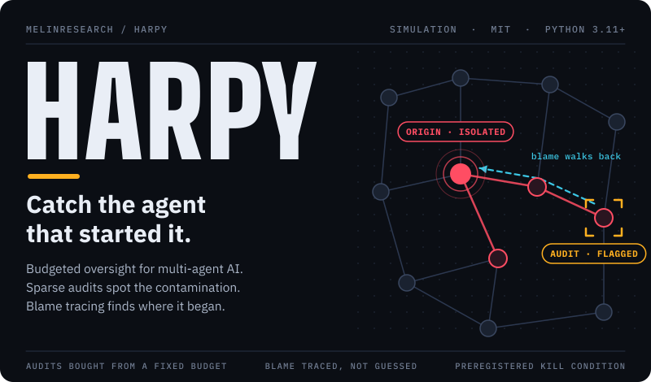
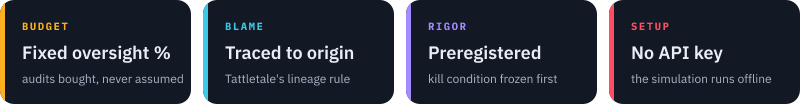
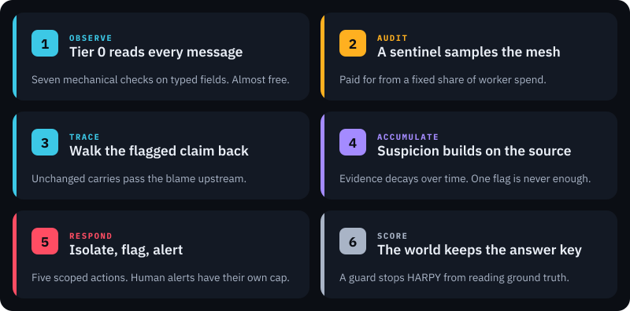
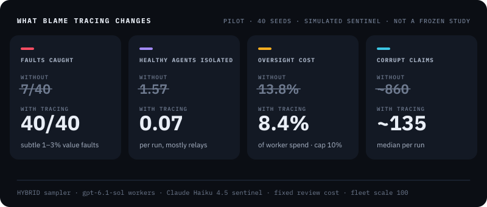
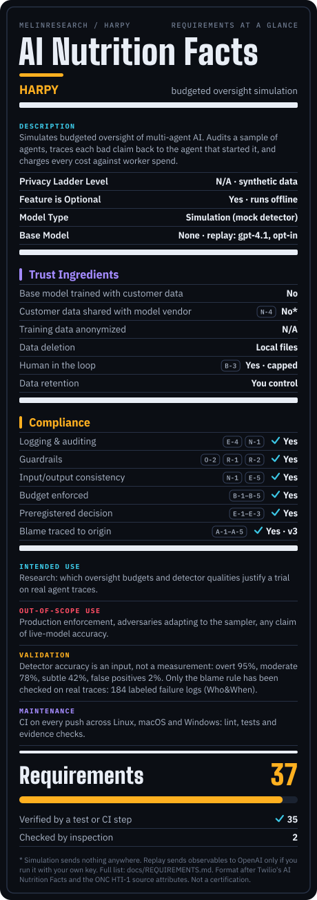
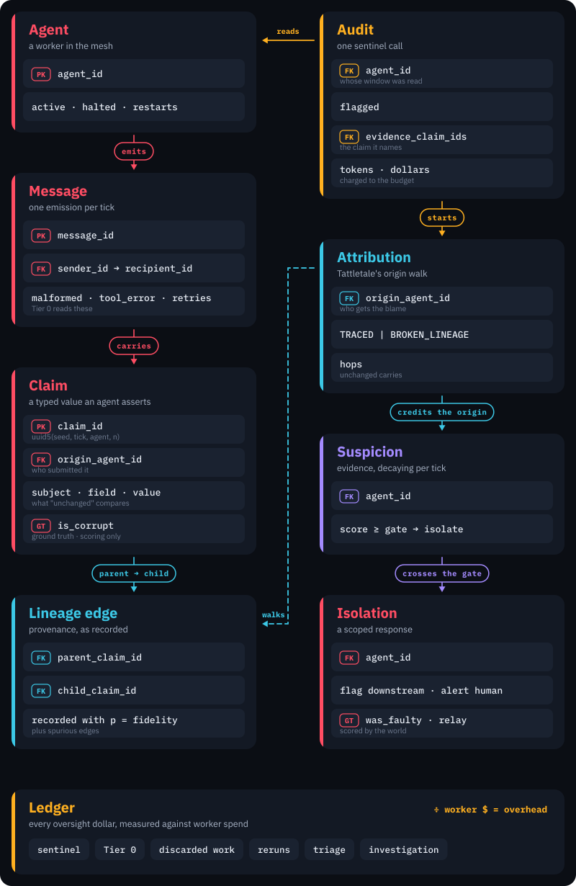

<p align="center">
  
</p>

In a multi-agent system, one agent goes wrong and the others repeat it. If you audit everything, oversight costs as much as the work. If you audit a sample, you mostly catch the agents repeating the error, not the one that started it.

**HARPY buys audits from a fixed slice of the budget, then traces each bad claim back to the agent that changed it.**

[](https://github.com/MeLinResearch/Harpy/actions/workflows/ci.yml)
**Python 3.11+** · **MIT** · **Research simulation: v2 published, v3 in design**

<p align="center">
  
</p>

## How it works

<p align="center">
  
</p>

The trace step uses [Tattletale](https://github.com/MeLinResearch/tattletale)'s origin rule. An agent that passed a claim along unchanged passes the blame upstream; an agent that changed it owns it. Every relay carrying the bad claim then counts as a witness against the source instead of a suspect.

## What tracing changes

<p align="center">
  
</p>

These numbers come from a pre-freeze pilot of 6,200 simulated runs. They held when the sentinel named the wrong claim half the time. They broke down when half the lineage records were missing. Full results, stress tests and the candidate study design are in [the v3 design notes](docs/STUDY_V3_DESIGN.md).

> [!IMPORTANT]
> **The sentinel is simulated.** `MockSentinel` flags audits with configured probabilities; it is not a model detecting anything. HARPY shows the conditions under which budgeted oversight could work. It does not measure real-model accuracy or production savings.
>
> Three assumptions need testing on real agent traces:
> - The sentinel can name the bad claim.
> - It flags a relay's restatement as readily as the original.
> - Your framework records which claim each claim came from.

## Try it

No API key and no paid model call. You need [uv](https://docs.astral.sh/uv/) and Python 3.11+.

```bash
git clone https://github.com/MeLinResearch/Harpy.git && cd Harpy
uv sync --extra dev
uv run pytest -q

# One v3 run: exposure sampling plus blame tracing, at sourced list prices
uv run harpy run --config configs/v3.yaml \
  --pricing configs/pricing.v3.claude-haiku-4-5.yaml \
  --arm EXPOSURE --attribution --severity SUBTLE \
  --worker-model gpt-6.1-sol --fleet-scale 100 --seed 100000 \
  --out results/try/
```

The run prints whether it caught the fault, what oversight cost as a share of worker spend, and where blame was traced. One run shows the tooling, not a finding. See [Run and inspect](docs/RUNNING.md) for sweeps, studies and `harpy feasibility`, which checks whether a study can pass before you freeze it.

## AI nutrition label

The label is HARPY's requirements at a glance, in the standard AI nutrition label format: [Twilio's AI Nutrition Facts](https://www.twilio.com/docs/conversations/intelligence/ai-nutrition-facts) fields plus the [ONC HTI-1](https://casrai.org/guides/hti-1-predictive-dsi-source-attributes) source-attribute categories.

Each compliance row names the requirements behind it, and each requirement names the test that checks it.

<p align="center">
  
</p>

- [**AI nutrition label**](docs/governance/AI_NUTRITION_LABEL.md): every field, with its backing requirements.
- [**Engineering requirements**](docs/REQUIREMENTS.md): all 37 requirements, how each is verified, and the v3 acceptance criteria.
- [**Data / model card**](docs/governance/DATA_MODEL_CARD.md): data origin, detector identity, evaluation, intended use.
- [**Data bill of materials**](docs/governance/DBOM.md): inputs, transformations, lineage and hashes, with a [machine-readable copy](docs/governance/dbom.json).

These are project documents, not compliance certifications.

## Data model

<p align="center">
  
</p>

Fields marked `GT` are ground truth. A runtime guard and a static source scan stop HARPY's side from reading them; only the mock sentinel and the scoring code may. See [Architecture](docs/ARCHITECTURE.md).

## Built to be checked

| Property | How it's enforced |
| --- | --- |
| Preregistered | A study writes its spec before any outcome, and a spec not marked `frozen` refuses to run. The v2 kill condition is [frozen](configs/study.v2.yaml): at least 10 points of detection over Tier 0 alone, under 10% overhead. |
| Reproducible | Same seed, byte-identical JSON. Separate random streams keep arms comparable. [Published v2 records](evidence/study-v2/) re-run exactly in CI. |
| No answer-key leaks | A call-stack guard plus a source scan keep ground truth out of the oversight path. |
| Budgets that bind | Audits are bought from dollars, and human alerts have their own cap. Six cost components are reported separately. |
| Evidence integrity | Every packet carries a SHA-256 manifest, and `harpy verify` detects changed, missing or unlisted files. |
| Honest replay | Labels stay separate from observations, provider errors are never verdicts, and paid calls need verified prices and a cost reservation. |

CI runs lint, the full test suite and every evidence check on Linux, macOS and Windows.

## Read more

| Document | What it covers |
| --- | --- |
| [V3 design notes](docs/STUDY_V3_DESIGN.md) | Why v2 couldn't pass, what v3 adds, the pilot, the candidate study. |
| [Engineering requirements](docs/REQUIREMENTS.md) | Requirements, verification and acceptance criteria. |
| [V2 study](docs/STUDY_V2.md) | The frozen v2 test and its INCONCLUSIVE result. |
| [V1 result](docs/V1_RESULT.md) | The record that v1 failed its economic test. |
| [Methodology](docs/METHODOLOGY.md) · [Architecture](docs/ARCHITECTURE.md) | How the simulation works and what it assumes. |
| [Run and inspect](docs/RUNNING.md) · [Replay](docs/REPLAY.md) | Commands, sweeps, studies, and measuring a real detector. |

## Related

[**Tattletale**](https://github.com/MeLinResearch/tattletale) checks quoted claims against their source and names the agent that introduced a bad one, not the one that last repeated it. HARPY uses its origin rule to decide who a flagged claim belongs to.

## License

[MIT](LICENSE). The README artwork is generated by [`docs/assets/build/build_art.py`](docs/assets/build/build_art.py).
